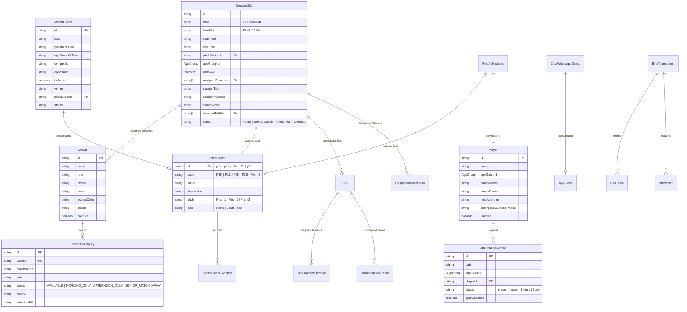

# Old Alex Coaching Hub — Current State System Audit & Architectural Review

**Target Organization:** Old Alexandra Hockey Club (Milltown, Dublin 6, Ireland)  
**Primary User Persona:** Richard Couse (`richardcouse7@gmail.com`), Director of Coaching / Head of Youth  
**Audit Date:** October 2026  
**Auditor:** Antigravity Senior Engineering & Architecture Team  
**Scope:** Complete Codebase Inspection, Data Model, User Flows, Technical Health & Strategic Roadmap

---

## Executive Summary

The **Old Alex Coaching Hub** is a specialized single-page web application (React 19, TypeScript, Tailwind CSS v4, Vite 8) purpose-built for coordinating Sunday youth hockey training, coaching allocations, pitch sectors, matchday fixtures, equipment, and communications at Milltown AstroTurf. 

The application has achieved substantial domain fidelity—capturing the authentic structure of Old Alexandra Hockey Club (15 real age-grade squads, 31 coaches, 5 pitch sectors across Pitch 1 and Pitch 2, Leinster Hockey pathways, and WhatsApp communications). However, the system currently operates as a **purely client-side, in-memory browser application reliant entirely on `localStorage`**, lacking server-side persistence, real-time multi-device sync, automated test coverage, or formal URL routing.

This audit provides a complete, unvarnished baseline of the system's architecture, capabilities, fragile areas, and technical debt prior to any further development.

---

## 1. Codebase & Structural Overview

### 1.1 Architecture & Stack
- **Framework:** React 19.0.1 (Single-Page Application)
- **Language:** TypeScript 7.0.2 (`strict: true`)
- **Build Tool:** Vite 8.3.1 with `@vitejs/plugin-react` and `@tailwindcss/vite`
- **Styling:** Tailwind CSS v4 with custom `.sun-mode` daylight high-contrast layer
- **Icons:** `lucide-react` (v0.546.0)
- **Audio Synthesizer:** Native Web Audio API (FM-modulated referee whistle)
- **Offline / Hardware:** Screen Wake Lock API, Service Worker registration, LocalStorage persistence

### 1.2 Codebase Metrics
- **Source Directory (`src/`):** 53 TypeScript/TSX files
- **Total Source Code Lines:** ~17,400 lines
- **Total Bundle Size (Production Build):** 330 kB JS (compressed ~80 kB gzip), 114 kB CSS
- **Test Files:** **0 files** (No Vitest, Jest, Cypress, or Playwright configured)
- **Phantom / Unused Dependencies:**
  - `express` & `@types/express`: Present in `package.json`, completely unused in Vite client build.
  - `@google/genai`: Present in `package.json`, zero imports in `src/`.
  - `motion`: Present in `package.json`, zero imports in `src/` (Tailwind CSS transitions used exclusively).
  - `dotenv`: Present in `package.json`, unused in client code (`import.meta.env` used).

---

## Section A: Current Product Map

The application consists of **11 primary tab views** and **15 modal / drawer dialogs**, all coordinated through top-level state in `src/App.tsx`.

```
Old Alex Coaching Hub
├── Primary Global Shell
│   ├── Collapsible Navigation Sidebar (src/components/Sidebar.tsx)
│   ├── Sticky Top Control Header (src/components/Header.tsx)
│   ├── High-Contrast Sun Mode Toggle (src/index.css, storageService.ts)
│   ├── PWA Installation Banner (src/components/Common/PWAInstallBanner.tsx)
│   └── System Error Boundary (src/components/Common/ErrorBoundary.tsx)
│
├── Primary Views (Tab Navigation)
│   ├── 1. Dashboard View (src/components/DashboardView.tsx)
│   │   ├── Sunday Readiness Metric & Pitch Utilization Gauge
│   │   ├── Real-time Collision Alerts (Double-booking, unassigned slots)
│   │   ├── Sunday Morning Preparation Checklist
│   │   └── 1-Tap WhatsApp Timetable Broadcast Trigger
│   │
│   ├── 2. Sunday Timetable (src/components/Timetable/SundayTimetable.tsx)
│   │   ├── Unified Single-Row Command Strip (Pathway pills, Pitch filters, Weather delay +15m)
│   │   ├── Spatial Pitch Matrix Grid (Two-pitch grouped visual headers: Pitch 1 & Pitch 2)
│   │   │   ├── Compact Action Cards (Squad badge, coach chips, drill count, readiness)
│   │   │   └── Interactive Dotted Turf Slots (+ Add session pre-filling time and sector)
│   │   ├── Chronological Timeline List View
│   │   └── Sunday Morning Quick-Actions Cockpit (src/components/Timetable/SundayMorningQuickActions.tsx)
│   │
│   ├── 3. Player Attendance & Safety (src/components/Attendance/PlayerAttendanceView.tsx)
│   │   ├── Squad Roll Call (Present, Absent, Injured, Late)
│   │   ├── Safety Check (Mouthguard & Shinguard confirmation)
│   │   └── Medical Alerts & Fast-Dial Emergency Contact Integration
│   │
│   ├── 4. Weekly Planner (src/components/WeeklyPlanner/WeeklyPlannerView.tsx)
│   │   ├── Monday-to-Sunday multi-day weekly overview
│   │   └── Cross-pitch weekday training session management
│   │
│   ├── 5. Fixtures & Matchday Hub (src/components/Fixtures/FixturesView.tsx)
│   │   ├── Leinster League, Cup, and Friendly match schedules
│   │   ├── Home vs Away pitch conflict detection
│   │   └── Quick Match Scorer & Result Modal (src/components/Fixtures/QuickScoreModal.tsx)
│   │
│   ├── 6. Drill Library (src/components/DrillLibrary/DrillLibraryView.tsx)
│   │   ├── 40+ Curated Hockey Drills across Foundation, Development & Youth Performance
│   │   ├── Leinster Curriculum Skill Filters (Passing, Receiving, 3D Elimination, Tackling)
│   │   ├── Interactive Tactical Whiteboard Sketcher (src/components/TacticalBoard/TacticalWhiteboard.tsx)
│   │   └── Animated Drill Playback Studio (src/components/TacticalBoard/TacticalDrillAnimator.tsx)
│   │
│   ├── 7. Coach Roster & Availability (src/components/CoachAvailability/CoachAvailabilityView.tsx)
│   │   ├── 31 Registered Old Alex Coaches Roster with Contact Info
│   │   ├── Weekly Availability Matrix (Available, Morning Only, Afternoon Only, Senior Match, Away)
│   │   ├── 1-Click Smart Auto-Assign Algorithm (Pool availability to unassigned pitch slots)
│   │   ├── Multi-Checkbox Mass Selection & Bulk Coach Deletion
│   │   └── Add / Edit Coach Modal (src/components/CoachAvailability/AddEditCoachModal.tsx)
│   │
│   ├── 8. Kit Shed & First Aid (src/components/KitShed/KitShedAndSafetyView.tsx)
│   │   ├── Sector Gear Allocation (Ball bags, bibs, cones, mini goals checkout/checkin)
│   │   └── First Aid Incident Logbook (Head knocks, stick strikes, treatment notes, parent notification)
│   │
│   ├── 9. Session Reviews & Debriefs (src/components/SessionReviews/SessionReviewsView.tsx)
│   │   └── Post-training reflection log (What worked, changes needed, focus for next Sunday)
│   │
│   ├── 10. Blitz Tournament Engine (src/components/Blitz/BlitzTournamentView.tsx)
│   │   ├── Round-robin tournament schedule generator
│   │   ├── Multi-pitch simultaneous match allocator
│   │   └── Live automated standings table (PTS, GD, GF, GA) & knockout progression
│   │
│   └── 11. Season Overview & Roadmaps (src/components/SeasonOverview/SeasonOverviewView.tsx)
│       └── Leinster Hockey youth milestones & age-grade curriculum targets
│
└── Secondary Modals & Dedicated Drawers (Lazy-Loaded in App.tsx)
    ├── Slot Inspector Drawer (src/components/Timetable/SlotSideDrawer.tsx)
    ├── Add Slot Modal (src/components/Timetable/AddSlotModal.tsx)
    ├── Schedule Spreadsheet Importer (src/components/Timetable/ScheduleImportModal.tsx)
    ├── Bulk Timings & Teams Editor (src/components/Timetable/BulkTimingsEditorModal.tsx)
    ├── Sunday Master Blueprints (src/components/Timetable/SundayMasterTemplatesModal.tsx)
    ├── Calendar Date Manager (src/components/CalendarManager/CalendarDateManagerModal.tsx)
    ├── Pitchside Companion Timer (src/components/PitchSideCompanion/PitchSideCompanionModal.tsx)
    ├── Export & Dispatch Hub (src/components/ExportHub/ExportHubModal.tsx)
    ├── Quick WhatsApp Share (src/components/WhatsAppExport/WhatsAppShareModal.tsx)
    ├── Director Pack Generator (src/components/DirectorPack/DirectorPackGeneratorModal.tsx)
    ├── Monthly Summary Report (src/components/MonthlyReport/MonthlyReportModal.tsx)
    ├── Push Broadcast Alert (src/components/NotificationModal.tsx)
    ├── Notifications Drawer (src/components/NotificationsDrawer.tsx)
    ├── Emergency Safety Protocol (src/components/Common/EmergencySafetyModal.tsx)
    └── Google Workspace Sync (src/components/GoogleIntegration/GoogleIntegrationModal.tsx)
```

---

## Section B: Current Data Model

The application models the domain through **22 TypeScript interfaces** located in `src/types/index.ts`. All relations are maintained as string ID references (foreign keys) without relational constraints or schema validation.



### Key Schema Observations & Constraints
1. **Static Union Types:** Age groups are locked to a compile-time TypeScript union:  
   `'PEN' | '1st Class' | '2nd Class' | '3rd Class' | '4th Class' | '5th Class' | '6th Class' | '1st Years' | 'Minors' | 'Inters'`. Adding boys' squads, transition squads, or changing naming conventions breaks TypeScript contracts across the codebase.
2. **Denormalized Redundancy:** `CoachAvailability` stores both `coachId` and `coachName`. If a coach's name is edited in the roster, `CoachAvailability` retains the stale string.
3. **No Schema Migration Layer:** Data stored in `localStorage` is serialized with `JSON.stringify()`. There is no versioned schema migration engine (e.g. Zod, Yup). If a type contract changes, stale objects in `localStorage` cause runtime `undefined` errors.

---

## Section C: Current User Flows

### Workflow 1: Mid-Week Schedule Ingestion & Allocation
1. **Richard receives the weekly schedule:** Typically as an Excel/Google Sheet from the club administrator or Leinster branch.
2. **Imports into Coaching Hub:** Richard clicks `Import` on the Sunday Command Strip, opening `ScheduleImportModal.tsx`.
3. **Parsing & Reconciliation:** The heuristic parser (`src/utils/scheduleImportParser.ts`) extracts rows, matches squad names, auto-identifies pitch sectors (P1N, P1S, P2N, P2S), detects floating standby coaches, and creates missing coach roster entries.
4. **Target Date Assignment:** Richard chooses whether to `Replace Existing Schedule` or `Merge`, reviews the preview table, and clicks `Apply Import`.
5. **State Commitment:** Slots are saved to `oldalex_session_slots_v2` in `localStorage`, and the view switches to the imported date.

### Workflow 2: Sunday Morning Pitch Allocation & Coach Balancing
1. **Bird's-Eye View:** Richard opens the Hub on his iPad or laptop. The **Spatial Pitch Matrix** displays Pitch 1 (Milltown Main) and Pitch 2 (Training Astro) across time rows (09:00, 10:45, 12:00, 13:15, 14:30).
2. **Conflict Resolution:** If a coach is double-booked or a slot lacks a coach, an amber conflict banner flashes at the top.
3. **Quick Assignment:** Richard taps an unassigned slot to open the `SlotSideDrawer.tsx` or uses the inline coach dropdown on the Compact Action Card to assign available coaches.
4. **Smart Auto-Assign:** If multiple coaches are free, Richard navigates to `Coach Availability` and taps `Smart Auto-Assign`, which matches available pool coaches to unstaffed slots.
5. **Weather Delays (Rain / Frost):** If Dublin rain delays pushback, Richard taps `Weather +15m` on the Command Strip, cascading a +15 minute shift to all sessions today.

### Workflow 3: Pitchside Training Execution (Field Companion)
1. **Outdoor Mode:** Standing pitchside in bright sunlight, Richard taps `☀️ Sun Mode` in the top bar to activate high-contrast white surfaces and bold borders.
2. **Launches Companion:** Richard taps `Pitchside Companion` from the sidebar or slot card.
3. **Lock & Audio:** The companion acquires an active screen Wake Lock (preventing iPad screen dimming) and initializes the Web Audio FM referee whistle.
4. **Drill Timer & Station Rotation:** The 75-minute countdown runs with 10-minute station interval warnings. When time expires, a double referee whistle blast sounds and screen flashes, prompting station rotation.
5. **Instant Incident Logging:** If a player twists an ankle or takes a ball contact, Richard taps `Log First Aid`, instantly routing to the Kit Shed incident log with player emergency contact fast-dial.

### Workflow 4: Broadcast & Dispatch to Club WhatsApp Groups
1. **Opens Export Hub:** Richard taps `Export Hub` or `Copy WhatsApp`.
2. **Template Selection:** Richard selects from 8 tailored templates (e.g. *Full Timetable*, *Technical Coach Briefing*, *Parent Update*, or *Weather Delay Notice*).
3. **Automatic Audience Routing:** The Hub resolves the target age group or squad to its designated WhatsApp group (e.g. `Old Alex U10 / 4th Class Parents`).
4. **Dispatch:** Richard taps `Send via WhatsApp` (`https://wa.me/?text=...`) or `Copy to Clipboard` to broadcast within seconds.
5. **Vault Backup:** Richard backs up the week's setup to Google Drive (`richardcouse7@gmail.com`) via `GoogleIntegrationModal.tsx`.

---

## Section D: Technical Health

### 1. Architectural Weaknesses

| Weakness | Severity | Impact |
| :--- | :--- | :--- |
| **No Central Backend Database** | **CRITICAL** | All data lives exclusively in browser `localStorage`. No multi-device sync (desktop edits do not appear on pitchside iPad). Clearing browser data wipes all club history. |
| **No URL Routing (Hash or History API)** | **HIGH** | The entire app is a state-switched single view. Refreshing the browser resets the view to the Dashboard. Deep linking to specific slots, dates, or drills is impossible. |
| **Mega-State Concentration in `App.tsx`** | **HIGH** | `App.tsx` contains 863 lines, managing 30+ separate states, 15 modal toggles, and passing props 3 levels down. Any state edit causes unnecessary top-level re-renders. |
| **Massive Monolithic Component Files** | **HIGH** | 5 files exceed 900 lines of code (`ExportHubModal`: 1,821 lines; `CoachAvailabilityView`: 1,114 lines; `SlotSideDrawer`: 1,007 lines; `DrillLibraryView`: 1,005 lines; `PitchSideCompanionModal`: 950 lines). Complex logic is tightly coupled to JSX rendering. |
| **Dual-State Out-of-Sync Risk** | **MEDIUM** | Sub-components (`PlayerAttendanceView`, `BlitzTournamentView`, `ExportHubModal`) read from `StorageService` during initialization rather than receiving state from `App.tsx`. Updates made in one view do not reliably notify other views without a manual refresh. |

### 2. Duplicated Logic & Fragile Areas

1. **WhatsApp Formatting Logic:** Implemented in `StorageService.generateWhatsAppCopy`, duplicated in `ExportService.generateCoachBriefingWhatsApp`, and partially re-written inside `WhatsAppShareModal.tsx`.
2. **Tactical Board & Diagram Rendering:** Canvas/SVG coordinate math, arrow rendering, and player node positioning are implemented separately across `TacticalDiagram.tsx`, `TacticalWhiteboard.tsx`, and `TacticalDrillAnimator.tsx`.
3. **Time Shifting & Parsing:** String parsing of time strings (e.g. `'10:45–12:00'`) using `.split('–')` or `.split('-')` exists in 6 distinct locations with subtle regex differences.
4. **Zero Automated Tests:** No unit tests verify schedule conflict detection, spreadsheet import parsing, or tournament standings algorithms.

---

## Section E: Top 10 Usability (UX) Issues

1. **Browser Refresh Resets All Context:**  
   If Richard is configuring a tactical drill or reviewing coach availability and accidentally refreshes, he is thrown back to the Dashboard on the default seed date.
2. **Local Edits Do Not Sync to Mobile / iPad:**  
   Creating or updating a schedule on a desktop requires manually exporting a JSON file and importing it on the pitchside tablet.
3. **Modal Stacking & Visual Trapping:**  
   Opening `Add Slot` from inside `SlotSideDrawer` or `Export Hub` creates stacked modal overlays where pressing Escape or clicking backdrop can close both dialogs, losing unsaved input.
4. **Monolithic Export Hub Clutter:**  
   `ExportHubModal` attempts to be an email client, PDF compiler, WhatsApp router, Google Drive uploader, and JSON vault all in one giant modal dialog.
5. **No Undo / Redo for Timetable Edits:**  
   Accidentally shifting timings or deleting a slot cannot be undone without manually re-entering the data or re-importing a backup.
6. **Hardcoded Age Groups Prevent Dynamic Squads:**  
   Richard cannot add temporary squads (e.g. "U8 Boys Blitz Team", "Senior Development Squad") because squad names are locked to the fixed 10 age-group schema.
7. **Small Touch Targets on Pitch Matrix Dropdowns:**  
   Inline coach dropdowns on the matrix cards are compact (`text-[10px]`); while space-efficient on desktop, they can be difficult to tap accurately on an iPad with cold fingers pitchside.
8. **Inconsistent Date Navigation:**  
   The date is picked in the top header, but navigating across multiple weeks requires using `Calendar Tools` in a separate modal dialog rather than simple previous/next week arrows.
9. **Drill Library Search vs Leinster Skill Hierarchy:**  
   Filtering drills by Leinster Curriculum skill keywords currently works via substring matching, occasionally returning false positives for unrelated drills.
10. **Kit Shed Checkout Disconnected from Slots:**  
    Equipment checkout is tracked per pitch sector rather than tied directly to the session slot or head coach assigned to that sector.

---

## Section F: Recommended 10-Step Development Roadmap

In strict dependency order:

```
[1. Routing Foundation] ──────► [2. Unified State Store] ──────► [3. Automated Test Harness]
                                                                        │
[5. Real-Time Cloud Sync] ◄──── [4. Decompose Monoliths] ◄──────────────┘
          │
          ▼
[6. Undo/Redo Engine] ────────► [7. Dynamic Squad Modeling] ───► [8. Modular Export Hub]
                                                                        │
[10. Offline ServiceWorker] ◄── [9. Touch-First Matrix Polish] ◄────────┘
```

1. **Step 1: Lightweight Client Routing (History / Hash Router)**  
   *Why First:* Allows deep linking (e.g. `/#/timetable?date=2026-09-13`, `/#/coaches`, `/#/drills/drill-4`) and stops browser refresh from resetting Richard's working view.
2. **Step 2: Unified State Store (Zustand or React Context Store)**  
   *Dependency on 1:* Replaces the fragile 30-prop chain in `App.tsx` with a single reactive store, eliminating the out-of-sync bugs between `StorageService` and child components.
3. **Step 3: Automated Test Harness (Vitest + React Testing Library)**  
   *Dependency on 2:* Install Vitest to lock in tests for core calculations: conflict detection, spreadsheet import parsing, blitz tournament standings, and WhatsApp formatting.
4. **Step 4: Decompose Monolithic Components**  
   *Dependency on 3:* Refactor `ExportHubModal.tsx` (1,821 lines), `CoachAvailabilityView.tsx` (1,114 lines), and `SlotSideDrawer.tsx` (1,007 lines) into clean, sub-feature components backed by tests.
5. **Step 5: Cloud Persistence & Multi-Device Sync (Firebase / Supabase / REST)**  
   *Dependency on 2, 4:* Migrate from browser-bound `localStorage` to a lightweight cloud database so desktop prep instantly syncs to Richard's pitchside iPad.
6. **Step 6: Timetable Undo / Redo Command History**  
   *Dependency on 2:* Implement an in-memory command stack (`undo()` / `redo()`) for schedule changes, weather shifts, and coach swaps.
7. **Step 7: Dynamic Age-Group & Squad Configuration**  
   *Dependency on 5:* Refactor `AgeGroup` from a hardcoded TypeScript union into database-configurable club squads with custom pathways and pitch allocations.
8. **Step 8: Standalone Modular Export Engine**  
   *Dependency on 4:* Break `ExportHubModal` into focused utilities: a clean WhatsApp drawer, dedicated PDF generator, and Google Drive vault.
9. **Step 9: Touch-First Pitch Matrix Refinements**  
   *Dependency on 1, 6:* Increase touch targets for pitchside iPad operation; add drag-and-drop or 2-tap coach quick-swapping.
10. **Step 10: Production PWA Service Worker & True Offline Cache**  
    *Dependency on 5:* Equip the PWA with IndexedDB caching and background sync for true zero-connectivity pitchside reliability.

---

## Section G: "Do Not Build" List

To protect Richard's core workflow and prevent needless bloat, the following items should **NOT** be built:

| Feature to Avoid | Rationale |
| :--- | :--- |
| **Full Parent-Facing Portal / Login System** | Old Alex already uses ClubZap / Pitchero for parent registrations and subs. Building parent logins adds GDPR liabilities, password resets, and massive overhead without helping Sunday morning pitch allocations. |
| **In-App Real-Time Chat System** | Coaches, managers, and parents already live on WhatsApp. An in-app chat will be ignored and requires maintaining WebSocket infrastructure. The current 1-tap WhatsApp deep links are vastly superior. |
| **Complex GPS Player Tracking / Wearables** | Club youth hockey does not require elite GPS telemetry. It clutters the interface and distracts from core coach staffing and drill execution. |
| **Complex Video Upload & Streaming Infrastructure** | Hosting and transcoding match video requires heavy cloud storage (AWS S3/CloudFront) and bandwidth costs. A simple external YouTube / Vimeo link field on drills and matches is sufficient. |
| **E-Commerce / Club Merchandise Shop** | Old Alex merchandise is managed via official club kit suppliers (e.g. Grays, Osaka, Uniformity). Adding a shopping cart adds unnecessary payment processing overhead. |
| **Heavy AI Text Generation on Simple Forms** | Generating session notes via heavy LLMs pitchside is slow, introduces hallucinations, and requires constant API keys. Richard needs rapid, predictable, tactile controls. |

---

*Report prepared and cataloged in repository: `docs/CURRENT-STATE-AUDIT.md`.*
